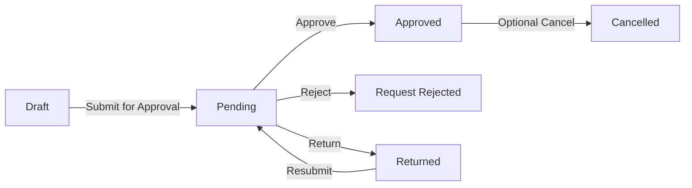

# Optional Expense Claim workflow example

My Work automatically uses an active workflow; it does not require or install this example. Configure business workflows in ERPNext according to your organization's approval policy.

## Example flow

| Current state | Action | Example role | Target state | Native decision | Target docstatus |
|---|---|---|---|---|---|
| Draft | Submit for Approval | Employee | Pending | Draft | 0 |
| Pending | Approve | Expense Approver | Approved | Approved | 1 |
| Pending | Reject | Expense Approver | Request Rejected | Rejected | 0 |
| Pending | Return | Expense Approver | Returned | Draft | 0 |
| Returned | Resubmit | Employee | Pending | Draft | 0 |
| Approved | Cancel | Expense Approver | Cancelled | Cancelled | 2 |

An approval transition must update `approval_status` **before native submission**. Claim/accounting status is still calculated by HRMS. A submitted Approved claim may remain Unpaid until the payment process finishes.

Review conditions, editable roles, self-approval, company/user restrictions and notifications for your own policy. The compatibility example retains a self-approval allowance; do not assume it is appropriate for every organization. Installing My Work does not grant any role or approval permission.

## Return, reject, and cancel

Return is for correction and resubmission. The example's Request Rejected is an unposted rejection; it avoids an invalid Draft-to-Cancelled transition. HRMS may require draft advance allocations to be removed before rejection, because rejected sanctioned amounts become zero. Removing a claim link does not delete the Employee Advance or its payments.

Cancellation applies only after submission and retains normal linked-document, accounting and advance reversal validations. It is optional administrative work, not an additional approval step that makes every paid claim pending again.

## Administrative helper

`my_work.workflow_setup` contains an explicit, non-whitelisted setup helper and native workflow-builder layout for this example. It is **not** an install/migration hook. It checks the expected workflow version, validates legacy state/docstatus compatibility, backs up configuration privately, saves through Frappe's Workflow model, and checks existing claim values. Review it and test on staging before running it against any site's existing workflow.

The example retains an isolated legacy Rejected state with docstatus 2 for compatibility; it does not rewrite existing submitted or cancelled claims. A scoped compatibility handler uses native Workflow Action services for return/resubmit cycles and does not turn arbitrary workflows into this example.
