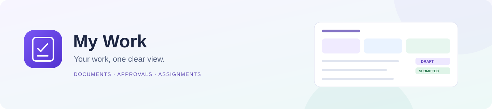
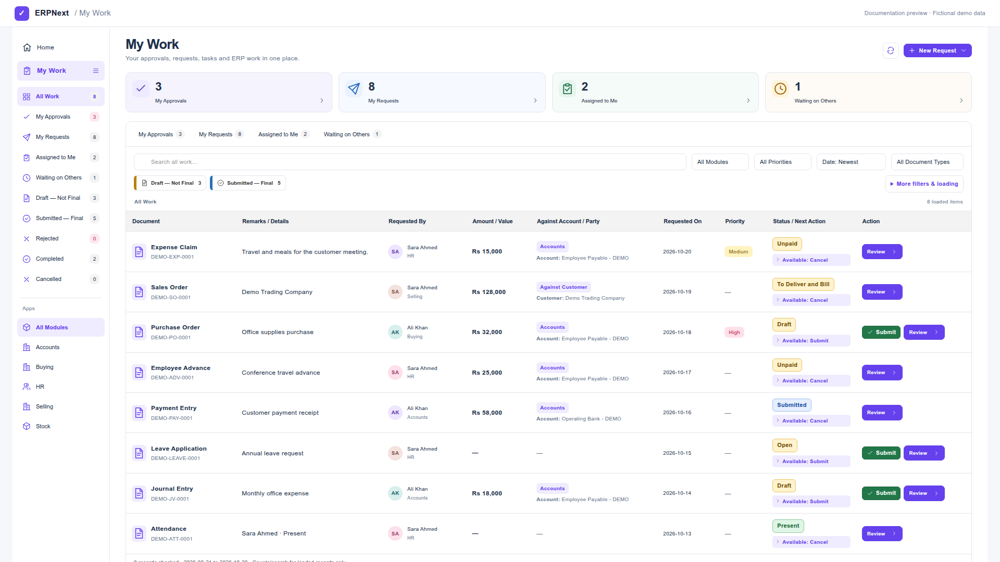
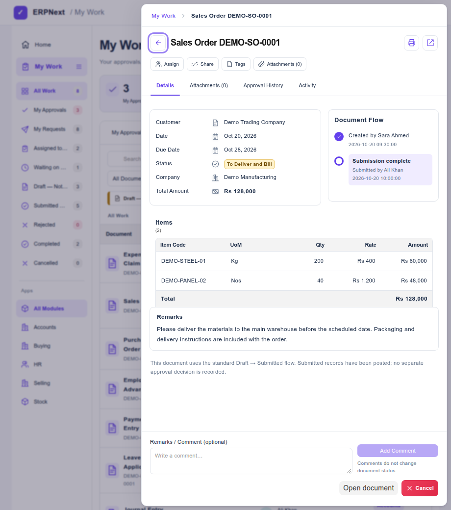
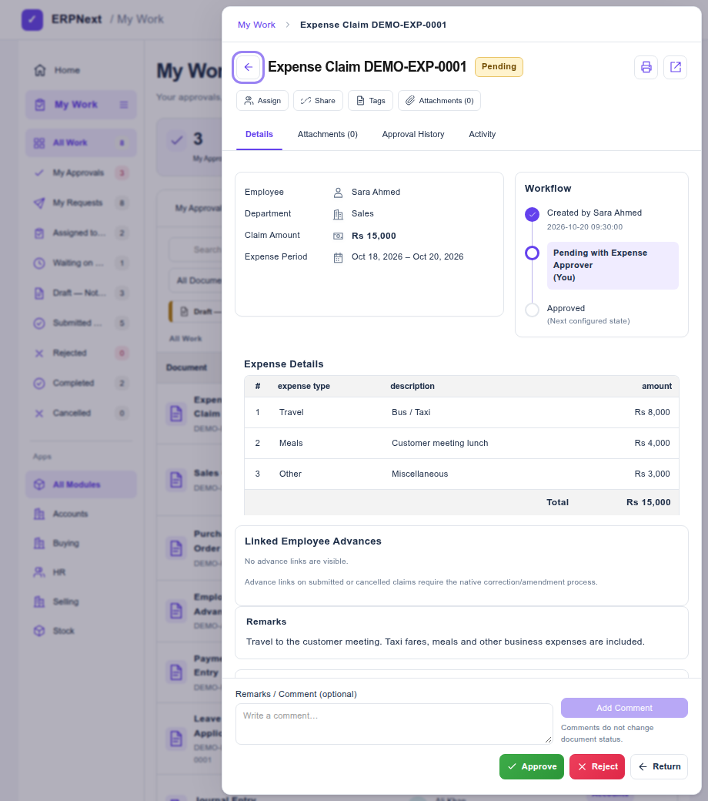

<div align="center">



# My Work

### Your ERPNext work. One clear view.

A permission-aware work inbox for **documents, approvals, assignments, and comments** — built for Frappe and ERPNext.

[](https://frappeframework.com)
[](https://erpnext.com)
[](license.txt)
[](https://github.com/ERPNEXT-PAKISTAN/My-Work)

[Overview](#a-calm-place-to-get-work-done) · [Screenshots](#a-closer-look) · [Install](#install) · [Configuration](#configure-your-inbox) · [Testing](VALIDATION.md)

</div>

---

## A calm place to get work done

Stop jumping between lists just to find what needs attention. **My Work** brings your readable business records, requests, approvals, and assignments into a focused workspace, with clear statuses and the next actions you can actually take.



> **Screenshot note:** All images render the actual My Work interface with fictional demo data. Names, documents, amounts, and workflows in these previews are illustrative, not production records.

| Your work | What you get |
|:--|:--|
| **One inbox** | All Work, My Approvals, My Requests, Assigned to Me, and Waiting on Others. |
| **Clear stages** | Separate **Draft — Not Final** and **Submitted — Final** views. Cancelled and saved-only records stay distinct. |
| **Automatic flow detection** | Uses the active custom workflow for a DocType; otherwise follows native submission for submittable documents. |
| **Focused Review** | Main information first, compact item tables, full-width remarks, and a document-flow timeline. |
| **Native collaboration** | Add comments independently of status. Access assignments, shares, tags, and attachments from Review. |
| **Bounded loading** | A recent-record window rather than loading your entire history before showing a page. |

## A closer look

### Review the information that matters

Main facts on the left. Actual progress on the right. Items, reference details, and full-width remarks follow below.



Sales Orders show **Customer, Date, Due Date, Status, Company, and Total Amount**. Purchase Orders use **Supplier** and their scheduled date. Item tables stay compact: **Item Code · UoM · Qty · Rate · Amount**, with a **Total** footer.

### Keep approvals in their proper workflow



Configured workflows retain their own states, conditions, roles, and permitted actions. The preview above illustrates an approval workflow; My Work does not create that workflow during installation.

<details>
<summary><strong>More Review features</strong></summary>

- A recorded submission shows **who submitted it and when**, using native Version history or existing My Work action audit entries. Missing history is not replaced with the document creator or last editor.
- **Add Comment** works independently on readable saved documents, including Draft, Submitted, and Cancelled entries. Comments use native Frappe services and appear in Activity.
- Comments do not submit a document. Unposted text and unsaved approval edits remain independent.
- The main status column shows one current system state and permitted next actions; detailed diagnostics stay in Review.
- Expense Claims include their native approval decision, payment route, readable advance links, and financial totals. Draft-only edits retain HRMS validations.
- Less important fields and secondary tables are kept near the end. The standard-flow explanation remains at the bottom.

</details>

## Two flows, detected automatically

| Document configuration | My Work behaviour |
|:--|:--|
| **No active custom workflow** | Native **Draft → Submit → Submitted**. Cancel is available only where the document and user permissions allow it. |
| **Active custom workflow** | Uses configured workflow transitions through Frappe's workflow API. Native submission shortcuts do not bypass it. |
| **Non-submittable saved record** | Shows the recorded state. Employee Checkin is not incorrectly treated as a draft awaiting submission. |

**Submitted means the document has been submitted.** It does not automatically mean approved, paid, delivered, or otherwise fulfilled. Native approval and business statuses retain their own meaning.

## Fast by keeping the scope clear

| Control | Default | Choices |
|:--|:--|:--|
| **Records to evaluate** | Latest **100** | 50 / 100 / 200 / 500 in the UI; server maximum 500. |
| **Updated date range** | Last **30 days** | 7 / 30 / 90 / 365 days, All dates, or explicit From/To dates. |
| **Rows per page** | **20** | 20 / 50 / 100. |

Module, DocType, date, native status, and applicable decision constraints run before full documents are loaded. Item details are delivered when Review is opened. Workflow Action lookups are limited to the workflow documents in the loaded window.

**Counts, search, and sorting refer to the loaded window, not lifetime history.** To find older work, select its document type and updated date range or raise the loading limit. **All dates still respects the record limit.** Open **More filters & loading** to adjust these controls.

## Install

Use an existing **Frappe v16 bench** and the Python/Node versions required by that bench. ERPNext and HRMS provide their respective business and HR DocTypes; HRMS is needed for Expense Claim and other HR-specific features.

From your bench directory:

```bash
bench get-app my_work https://github.com/ERPNEXT-PAKISTAN/My-Work.git
bench --site your-site.example install-app my_work
bench build --app my_work
bench --site your-site.example clear-cache
bench restart
```

Then open **`/desk/my-work`**, the **My Work** app icon, or the **My Work Overview** workspace. Users need Desk access and the normal permissions for the documents they want to see.

Installation adds the app's Page, navigation, and workspace. It does **not** install sample business data, configure business workflows, or grant approval roles.

## Configure your inbox

The defaults discover supported readable workflow documents, native submittable documents, and Employee Checkin. You can narrow discovery with the `my_work` key in your site's configuration:

```json
{
  "my_work": {
    "enabled_doctypes": [
      "Expense Claim",
      "Sales Order",
      "Purchase Order",
      "Employee Advance",
      "Employee Checkin",
      "Attendance",
      "Leave Application"
    ]
  }
}
```

Without an allowlist, supported readable types are discovered automatically. Native personal discovery covers owned records, supported Employee-to-User relationships, and readable designated approver links; it is not a list of every transaction a manager can read.

<details>
<summary><strong>Requester mappings and custom display fields</strong></summary>

```json
{
  "my_work": {
    "requester_fields": {
      "Your Request DocType": {
        "requested_by": "user"
      }
    },
    "display_fields": {
      "Your Request DocType": [
        "company",
        "posting_date",
        "status",
        "total_amount"
      ]
    }
  }
}
```

Mappings accept `user` for a User link and `employee` for an Employee linked to the current User. Map trusted identity fields. Existing document and field permissions still govern visibility. Explicit configuration can override the default summary fields.

</details>

After changing configuration or activating/deactivating a workflow, clear the site's cache and refresh My Work.

## Permissions and operational readiness

My Work uses permission-filtered discovery, document read checks, field permissions, native submit/cancel methods, and Frappe workflow services. Document actions use version checks and row locking. Native validations, linked-document restrictions, and accounting/stock hooks remain authoritative. Guest and website-only sessions cannot access the Desk inbox.

This is an independently developed Frappe app. It is suitable for a **controlled rollout**; validate your actual submit/cancel, permission, workflow, and concurrent-user scenarios on staging before broad production deployment. A record cap bounds the number of full documents evaluated, not every database operation or the execution time of your custom hooks. See [validation and known limits](VALIDATION.md).

## Development

```bash
# From the bench directory: isolated Python service tests
./env/bin/python -m unittest discover \
  -s apps/my_work/my_work/tests -p 'test_*.py' -q

# DOM / route / workflow-builder tests; dev dependencies stay inside tests/
npm --prefix apps/my_work/tests ci
npm --prefix apps/my_work/tests test
```

The JavaScript checks expect this app beside `frappe` in a bench. They use synthetic records; no production browser or financial transaction is controlled. To regenerate the documentation images, run `node apps/my_work/scripts/render-docs.cjs` from the bench, with Google Chrome available. The renderer uses the actual app code and fictional fixtures and never connects to a site.

| Source | Purpose |
|:--|:--|
| [`my_work/api.py`](my_work/api.py) | Inbox, Review, native actions, comments, and history. |
| [`my_work/loading.py`](my_work/loading.py) | Date scopes, query constraints, and loading caps. |
| [`my_work/document_details.py`](my_work/document_details.py) | Permission-filtered summaries and compact child tables. |
| [`my_work/document_events.py`](my_work/document_events.py) | Recorded submission/cancellation attribution. |
| [`my_work/claim_tools.py`](my_work/claim_tools.py) | Native collaboration and Expense Claim tools. |

## Documentation

- [Validation, testing, and known limits](VALIDATION.md)
- [Expense Claim status meanings](EXPENSE_CLAIM_STATUSES.md)
- [Optional Expense Claim workflow example](EXPENSE_CLAIM_WORKFLOW_GUIDE.md)

## Contributing

Issues and pull requests are welcome. Describe the DocType, native/workflow mode, expected behaviour, and a reproducible example using anonymized data. Include relevant validation for permission-sensitive or financial actions.

## License

[MIT](license.txt) · Maintained by [ERPNEXT-PAKISTAN](https://github.com/ERPNEXT-PAKISTAN).
